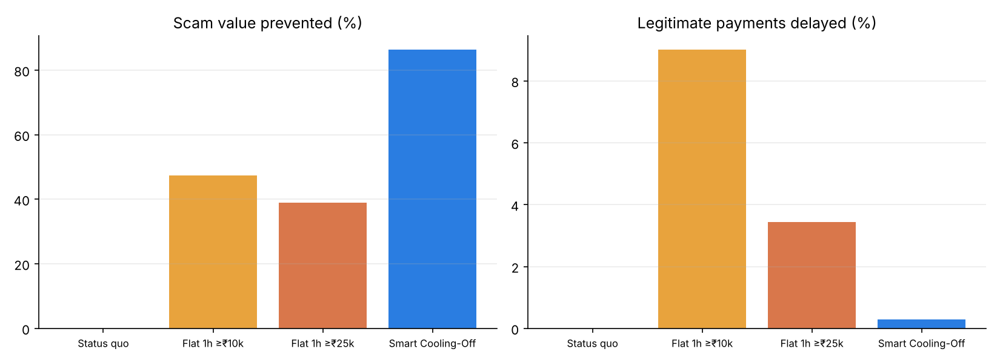
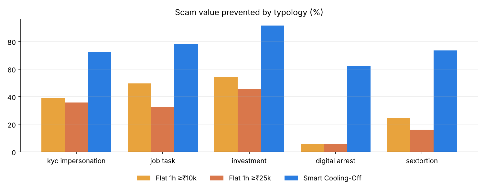

# Smart Cooling-Off — risk-based intervention engine for UPI / IMPS scam payments

A working prototype of a **risk-based alternative to a flat payment delay** for authorised
push payment (APP) scams in India. It is built on synthetic data and benchmarked against the
options in RBI's April 2026 discussion paper.

> **Problem.** On 9 April 2026 RBI's Department of Payment and Settlement Systems released
> *"Exploring safeguards in digital payments to curb frauds"*. Its main proposal is a
> **mandatory 1-hour lag on APP transfers ≥ ₹10,000**, with payee whitelisting. Banks broadly
> support a lag but asked for a **₹25,000** threshold. Critics point out that a flat timer:
> - adds friction to millions of genuine payments;
> - is easily bypassed, because coached victims are told to whitelist the fraudster;
> - does little in *digital-arrest* scams, where the fraudster stays on a video call for hours.
>
> **Question this repo answers.** Can a bank decide *which* payments to slow down, for *how long*
> and with *what kind* of intervention, and stop more scam value with far less friction?

---

## Results (synthetic data, 20-day out-of-time test window)

| Policy | Scam value prevented | Legit payments delayed | Legit payments ≥ ₹10k delayed | Friction cost | Net benefit |
|---|---:|---:|---:|---:|---:|
| P0 Status quo (instant) | 0% | 0% | 0% | ₹0 | ₹0 |
| P1 RBI Option 1 — flat 1h ≥ ₹10k + whitelist | 47.4% | 9.0% | 51% | ₹16.1 L | ₹104.5 L |
| P2 Banks' ask — flat 1h ≥ ₹25k + whitelist | 39.0% | 3.4% | 20% | ₹6.1 L | ₹93.1 L |
| **P3 Smart Cooling-Off (this repo)** | **86.3%** | **0.29%** | **1.3%** | **₹1.9 L** | **₹217.9 L** |

Smart Cooling-Off delays **~31× fewer genuine payments** than the flat ₹10k rule and prevents
**~1.8× more scam value**. The biggest gain is in **digital-arrest** scams: 6% prevented by a flat
timer, 62% by Smart Cooling-Off. The difference comes from replacing a passive timer with an
*active* bank call-back when the coaching pattern is detected.




**Stress test.** Adding noise to the model (PR-AUC falling from 0.75 to 0.40) keeps prevention at
about 86%. The cost of a weaker model shows up as friction instead: delayed legit payments rise
from 0.29% to 3.4%, still well below the flat ₹10k rule's 9%. See `stress_test` in
`reports/results.json`.

**Model (LightGBM, out-of-time):** ROC-AUC 0.991, PR-AUC 0.75. It catches 85% of scam payments
(92% of scam value) while flagging just 1% of traffic.

> ⚠️ Absolute numbers come from **synthetic data with inflated prevalence** and assumed
> intervention effectiveness (`src/scooler/config.py`). Treat them as a demonstration of the
> *method* and of the *relative* comparison, not as forecasts. See [Limitations](#limitations).

---

## How it works

```
 Payment initiated (UPI / IMPS / NEFT, P2P)
        │
        ▼
 ┌────────────────────┐   payer profile · session/device · telco call context
 │  Feature assembly  │◄─ payee intel (MuleHunter.AI score, CFCFRMS/1930 hits, DPIP)
 └─────────┬──────────┘   velocity (real-time feature store)
           ▼
 ┌────────────────────┐
 │ Risk model (GBM)   │──► calibrated p(scam) + SHAP reason codes
 └─────────┬──────────┘
           ▼
 ┌────────────────────────────────────────────────────────────┐
 │ Policy engine: expected loss = p × amount  +  guard-rails  │
 │   G1 trusted repeat payee → never delayed when low risk    │
 │   G2 coached-victim pattern → active call-back, not timer  │
 │   G3 RBI Option 2: 70+/PwD, new payee ≥ ₹50k → call-back   │
 │   G4 CFCFRMS-reported + high mule score → block            │
 └─────────┬──────────────────────────────────────────────────┘
           ▼
  allow │ nudge (contextual warning) │ cool_60 (cancel window) │ hold_callback (≤4h) │ block
```

| Action | What the customer sees | When |
|---|---|---|
| `allow` | Instant payment | Low expected loss / trusted payee |
| `nudge` | Typology-specific warning + re-confirm, no delay | EL ≥ ₹10 |
| `cool_60` | Provisional debit, 60-min cancel window, SMS alert; payee re-screened during the window | EL ≥ ₹500 |
| `hold_callback` | Hold ≤ 4h until bank or trusted person confirms by phone | EL ≥ ₹1,000, or guard-rail G2 / G3 |
| `block` | Declined, referred to 1930 | p ≥ 0.85 or guard-rail G4 |

Thresholds are **tuned automatically** (`simulate.tune_thresholds`). The tuner maximises
*prevented loss − friction cost* on a validation window, subject to delaying at most 1% of
genuine payments.

### Synthetic data
`src/scooler/data_generator.py` simulates 20,000 customers over 60 days: about 360k
account-to-account transfers and 240 scam incidents (about 1,150 scam payments). It covers five
Indian typologies modelled on I4C/NCRP 2025 reporting: **investment**, **digital arrest**,
**job/task**, **KYC impersonation** and **sextortion**. Scam value comes out at about 70%
investment and 12% digital arrest, close to I4C's 2025 split of 77% and 8%. Realism features:
- rented aged mule accounts;
- legitimate small-business payees that look mule-like;
- partial telco/device signal coverage (55% / 70%);
- MuleHunter-style scores that miss about 35% of mules;
- escalating payment chains, where stopping one payment can break the whole incident.

---

## Run it in VS Code

1. `git clone https://github.com/bks1984/upi-smart-cooling-off.git && code upi-smart-cooling-off`
2. Install the recommended extensions when prompted (Python, Debugpy, REST Client).
3. **Terminal → Run Task → "Setup: create venv & install requirements"**, then select `.venv` as
   the interpreter.
4. **Run and Debug (F5)** has three launch configs:
   - `1. Run full pipeline`: generates data, trains, tunes, compares policies, writes `reports/` (~1 min)
   - `2. Start decision API`: open http://127.0.0.1:8000/docs, or use `examples/requests.http`
   - `3. Run tests`

Command line equivalent:
```bash
python -m venv .venv && source .venv/bin/activate   # Windows: .venv\Scripts\activate
pip install -r requirements.txt
python scripts/run_pipeline.py
uvicorn scooler.service:app --app-dir src --reload
pytest -q
```

Example API response for a 72-year-old on a 140-minute unknown video call, paying ₹1.85 lakh to a
30-day-old account:
```json
{"action": "block", "p_scam": 1.0, "guardrail": "high_risk_block",
 "reasons": ["Amount far above customer's normal", "Beneficiary account is newly opened",
             "Very long ongoing call (coaching pattern)"],
 "customer_message": "This payment was stopped because it matches a known scam pattern. Police, CBI, RBI or customs NEVER ask you to transfer money ..."}
```

## Repo layout
```
src/scooler/
  config.py          regulatory parameters + every modelling assumption, in one place
  data_generator.py  synthetic customers, legit transfers, 5 scam typologies, mule pool
  features.py        29 features + human-readable reason-code text
  model.py           LightGBM + isotonic calibration + SHAP reason codes
  policy.py          expected-loss tiers + guard-rails + contextual warnings
  simulate.py        counterfactual policy simulator, threshold tuner, stress test
  service.py         FastAPI real-time decision endpoint
  reporting.py       charts
scripts/run_pipeline.py   end-to-end run
tests/                    unit tests for guard-rails, simulator, generator
examples/                 sample API payloads (+ requests.http for VS Code REST Client)
docs/solution_design.md   architecture, data sources, governance (FREE-AI), rollout plan
reports/                  results.json + charts from the last run
```

## Limitations
- **Synthetic data.** Victim prevalence is inflated about 5–10× so the model has enough positives.
  Signals are cleaner than production data, so real PR-AUC will be lower.
- **Intervention effectiveness is assumed**, not measured (`config.Effectiveness`). A real
  rollout should measure it with A/B or champion–challenger tests.
- **Friction costs are rough rupee equivalents** of inconvenience and operations cost.
- **Telco call-context signals** assume a consented telco API, which is not generally available today.
- **Scope.** Merchant, recurring and cheque payments are exempt, as in the RBI proposal, and are
  not simulated.

## References
- RBI DPSS, *Exploring safeguards in digital payments to curb frauds*, discussion paper, 9 Apr 2026.
- RBI, *FREE-AI Committee Report: Framework for Responsible and Ethical Enablement of AI*, Aug 2025.
- RBI Annual Report 2025-26, Ch. IX: Digital Payment Intelligence Platform (DPIP), Payments Vision 2028.
- RBIH, MuleHunter.AI (live in 26+ banks); IDPIC pilot with 8 banks (Sep 2026).
- I4C / NCRP 2025 cyber-fraud loss data (investment ≈ 77%, digital arrest ≈ 8% of losses).
- UK PSR APP-fraud reimbursement regime and Payment Services (Amendment) Regulations 2024
  (risk-based delays of up to 4 business days); Singapore cooling-off periods and kill switch.

*Prototype for research and discussion. Not affiliated with RBI, NPCI or any bank.*
